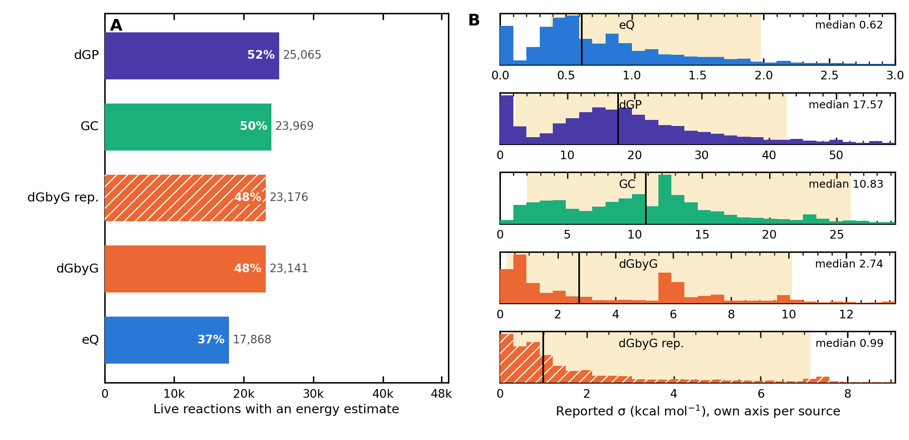
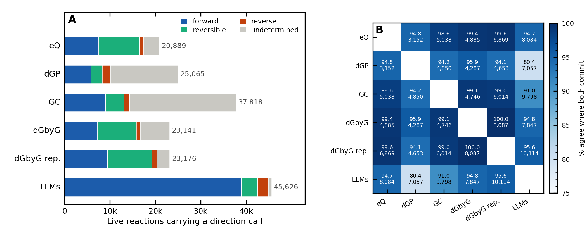
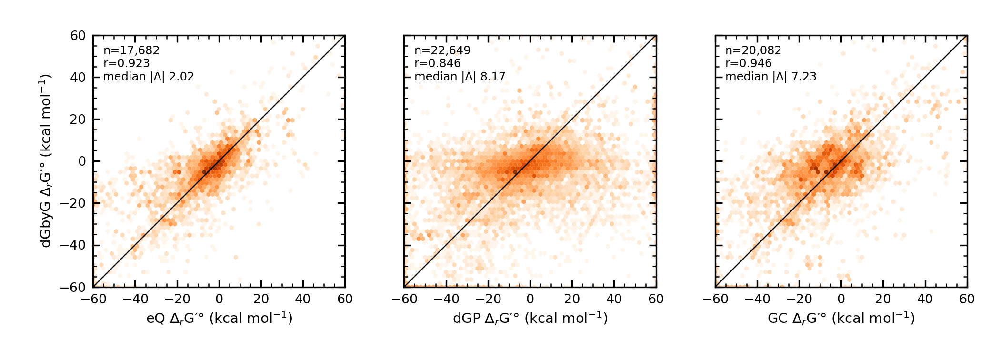
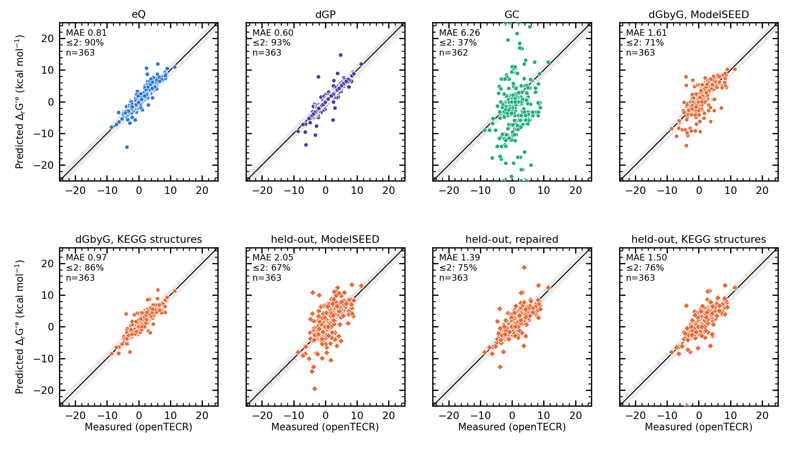
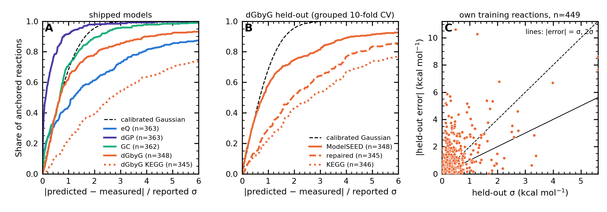

# dGbyG on the ModelSEED Biochemistry Database

Compared with eQuilibrator, dGPredictor, group contribution, openTECR measurements and the LLM ensemble, following the comparisons of the MSDB thermodynamics manuscript (`MSDB_thermo_paper`, sections M05/M06/M11/M12 and supplements S2–S4).

*Generated by `make_report.py` from `results/`; every number is read from the result files (the manuscript's own published values are quoted as such). Energies are standard transformed reaction Gibbs energies ΔrG′° in kcal/mol, reaction as written in ModelSEED. Population: the live (non-obsolete) records, as the manuscript counts them (48,384 reactions).*

## Summary

- **Coverage.** dGbyG gives a ΔrG′° for **23,141 of 48,384 live reactions (47.8%)**, against eQuilibrator 17,868, dGPredictor 25,065 and group contribution 23,969. It overlaps the existing sources almost entirely — 146 reactions get an energy from dGbyG alone. It declines reactions with an R-group participant (9,946), a participant without a structure (10,314), pure transport that nets to nothing (2,752) and mass-imbalanced reactions its balance check rejects (2,140; 2,095 of them flagged 'MI' by ModelSEED itself).
- **Uncertainty and resolution.** Median reported σ is **2.74 kcal/mol** (eQuilibrator 0.62, group contribution 10.83, dGPredictor 17.57). Under the paper's eQuilibrator/dGPredictor direction rule (reversibility index; irreversible when |ln Γ| − σ > ln 1000) dGbyG **resolves 72.0%** of what it covers (eQuilibrator 97.4%, dGPredictor 40.1%; group contribution, on its own historical cascade, 59.7%). That share includes 428 automatic '=' calls at σ = 0, a model blind spot (§3).
- **Direction agreement.** Where both commit, dGbyG agrees with eQuilibrator **99.4%** (n = 4,885), group contribution 99.1% (n = 4,746) and dGPredictor 95.9% (n = 4,287); the paper's eQuilibrator–dGPredictor figure is 94.8%. These pairs are dominated by large energies (median |ΔG_eQ| 26.4 kcal/mol) from sources that share TECRDB training data, so they show consistency, not accuracy. dGbyG states a direction for **1,294 of the 23,790 reactions** no shipped predictor directs (707 irreversible; 90 of the stated and 76 of the irreversible are reactions ModelSEED flags as charge-imbalanced).
- **Energies.** By median, dGbyG is much closer to eQuilibrator (median |Δ| 2.02 kcal/mol, r 0.923, n = 17,682) than dGPredictor is (6.28, r 0.728). The tail is wide: 26.5% of shared reactions differ by more than 5 kcal/mol (RMSE 13.93), and by Pearson r group contribution tracks eQuilibrator as closely (0.928).
- **Accuracy against measurement** (363 distinct live openTECR anchors). As shipped, dGbyG on ModelSEED structures has MAE **1.61** kcal/mol, 71.1% within 2 kcal/mol; eQuilibrator 0.81 / 89.5%, dGPredictor 0.60 / 93.4%, group contribution 6.26 / 36.7%. Every one of these is in-sample except group contribution: all 363 anchors are dGbyG training reactions, and eQuilibrator and dGPredictor are fitted to the same TECRDB measurements. Retrained with the anchor withheld (grouped 10-fold CV), dGbyG's MAE is **2.05** on ModelSEED structures, 1.39 on repaired structures and 1.50 on its native KEGG structures; on the 211 anchors whose reaction is genuinely new to the fold model (no indistinguishable training twin, not all formation energies in training) these become 2.56, 1.69 and 1.89.
- **Which truth.** The anchors are medians of raw measurements at their own pH and temperature (only 123 of 363 measured entirely within pH 6.5–7.5). Against the same measurements transformed to pH 7 / I 0.25 / pMg 14 (dGbyG's training targets, MAE 0.48 from the anchors), eQuilibrator scores 0.51 and dGPredictor 0.88 (against the anchors 0.81 / 0.60): the ordering among the in-sample sources depends on which processing of the measurements is taken as truth.
- **Structure representation costs dGbyG at least as much as generalisation does.** ModelSEED's pH-7 charged forms survive dGbyG's uncharger and its amides are drawn as imidic acids; neither occurs in dGbyG's training structures. In-sample, dGbyG's anchor MAE is 0.97 on its own KEGG structures and 0.96 on ModelSEED structures after neutralising and restoring amides (`structure_repair.py`). Held out, the repair cuts the MAE from 2.05 to 1.39 (0.66), while withholding the anchors adds 0.43 on repaired structures (which also includes retraining on 90% of the data with 20 heads). The repair was designed after inspecting these anchors, so 'held out' refers to the model, not the repair.
  Database-wide the repair lowers dGbyG's median σ from 2.74 to 0.99 kcal/mol and raises the resolved share from 72.0% to 87.7%. A smaller σ means the heads agree on familiar-looking inputs, not that the values are more accurate (only 30.1% of anchors within 1σ); of the 2,428 reactions it newly commits, eQuilibrator commits on 1,997 and agrees on 99.85%.
- **Calibration.** On its own training reactions held out by a reaction-grouped 10-fold CV, dGbyG's error exceeds its σ by a median factor of **2.33** and only **26.2%** falls within 1σ (68% if calibrated) — about eQuilibrator's position in its own CV (2.27, 28.7%; M11) and far from dGPredictor's (0.29, 87.9%). Adding each target's measurement scale in quadrature still leaves 1.53 and 34.8%. Its held-out median |error| there is 0.92 kcal/mol (eQuilibrator 0.27 and dGPredictor 0.45 in their measurement-row CVs, which are less strict). On the anchors the shipped model looks better calibrated on ModelSEED structures (62.4% within 1σ) than on its native ones (22.3%) only because unfamiliar structures inflate the spread of its heads.
- **Grading.** In the paper's gold/silver/bronze scheme (shipped files unmodified; three grading functions rebuilt in-process to register dGbyG), dGbyG raises live gold reactions from 4,073 to 6,255. Of the 1,976 that are gold only through dGbyG, 1,914 also carry an eQuilibrator value (1,827 eQuilibrator-silver; median |dGbyG − eQ| 0.68 kcal/mol), and dGbyG's grading curve is calibrated mostly on agreement with eQuilibrator, its proxy — so these upgrades record agreement with eQuilibrator at small dGbyG σ, not independent evidence; 413 of dGbyG's 2,812 gold grades rest on σ = 0. Withholding the σ = 0 rows gives 6,111 gold. The relevant evidence is the leak-free validation: dGbyG gold with held-out anchor values is within 2 kcal/mol 89.6% of the time (eQuilibrator gold 89.8%, dGPredictor gold 96.1%).
- **LLM ensemble.** dGbyG agrees with the LLM council where both commit 94.8% (κ 0.52, n = 7,847), close to eQuilibrator (94.7%, κ 0.55). Adding dGbyG leaves 21,460 reactions directed by the LLMs alone (was 22,738).



*Figure 1 (analogue of manuscript Fig. 2B/C). A: live reactions with an energy, per source. B: reported σ, own axis per source, 97th-percentile clip; black line = median, yellow band = 5th–95th percentile of σ on reactions the shipped (3-source) scheme grades silver.*

## 1. What was computed

| stage | script | what | output |
| :--- | :--- | :--- | :--- |
| 1 | `predict_compounds.py` | dGbyG ΔfG′° for every ModelSEED compound with a SMILES (100 heads) | `results/compound_predictions.tsv`, `compound_heads.npy` |
| 2 | `predict_reactions.py` | reaction ΔrG′°, σ, status and direction call for every reaction record | `results/reaction_predictions.tsv` |
| 1–2r | same, `--variant repaired` | the same on structures repaired by `structure_repair.py` | `results/repaired/` |
| 3 | `structure_sensitivity.py` | dGbyG on ModelSEED vs its native KEGG structures at the anchors | `results/structure_sensitivity/` |
| 4 | `cv_train.py`, `cv_predict.py`, `anchor_novelty.py` | grouped 10-fold retraining of dGbyG; held-out predictions of its training rows and the 363 anchors; how novel each anchor is to its fold | `results/cv/` |
| 5 | `compare.py` | coverage, σ, directions, agreement, anchors, calibration, LLM layer, diagnostics | `results/comparison/` |
| 6 | `grade_with_dgbyg.py` | the paper's grading with dGbyG as a fourth source | `results/grading/` |
| 7 | `direction_accuracy.py` | direction against measurement; source-selection strategy table | `results/direction/` |
| 8 | `export_for_modelseed.py` | database-shaped dGbyG triples | `results/modelseed_dgbyg_*.tsv` |
| 9 | `make_figures.py`, `make_report.py` | figures and this report | `results/figures/`, `REPORT.md` |

### Methods in brief

- **Model and condition.** The shipped dGbyG v2 ensemble (`models/mpnn_A139_B23_E300_L2_v2`, 100 heads), at its native condition: pH 7.0, I 0.25 M, pMg 14, 298.15 K. The database reports at pMg 3.0; dGbyG's transform has no Mg-binding constants (it moves only explicit Mg atoms). kJ/mol are divided by 4.184.
- **Structures.** Each compound's ModelSEED `smiles`, normalised by dGbyG itself. The 'repaired' variant first neutralises without explicit H and rewrites non-aromatic imidic acids as amides (§2.8).
- **Reactions.** Stoichiometry netted by compound across compartments (as the eQuilibrator and dGPredictor sublists are), H⁺ dropped (its ΔfG′° is 0 at fixed pH). The value is the mean over heads of the summed per-head vector, and **σ is the standard deviation of that summed vector** — dGbyG's own `Reaction.standard_dGr_prime`; compound σ's are not added in quadrature (they are strongly correlated). A reaction gets a primary estimate only if it passes dGbyG's balance check on dGbyG-normalised structures and has no R-group participant. eQuilibrator and dGPredictor leave out the same populations (of the 9,946 R-group and 2,752 null-net reactions they score 4 and 9); group contribution scores 1,929 of the null-net transports, all as exactly 0 ('='), which count toward its coverage and resolved share.
- **Direction.** The paper's eQuilibrator/dGPredictor rule set (`reversibility_heuristics.heuristics_for_source('dGPredictor')`: ATP synthase forced '=', then |ln Γ| − 1·σ_lnΓ > ln 1000 → '>' or '<', else '=' when the bar fits inside the band or is tight, else '?'), applied to the values rounded to 2 dp as the database stores them. A 'dGbyG' label would silently fall back to group-contribution rules; that was avoided and verified (every operator reproduces).
- **Definitions** (from the manuscript's scripts, reproduced exactly): live = `is_obsolete != 1`; covered = energy present with dG < 1e7 and |σ| < 2500; resolved = '>', '<' or '='; committed = '>' or '<'; agreement = equal operators where both commit; median σ = `sorted(σ)[n//2]`.
- **Anchors.** The 363 distinct live stereo-exact openTECR reactions of `opentecr_comparison.csv` (`opentecr_dG_kJ`/4.184, already in ModelSEED orientation): medians of −RT ln K′ over measurements at their own pH and temperature, untransformed.
- **Held-out predictions.** dGbyG retrained 10 times on its own recipe (`examples/train_the_model.ipynb`: target noise, weights, 9,000 full-batch epochs, best epoch) with 20 heads per fold, each fold withholding about a tenth of the 671 training rows. Folds are grouped by an orientation-, scale- and **stereo**-invariant reaction key, because dGbyG's graph features carry no chirality (a stereo twin left in training would leak its target). Each anchor is matched to its training reaction through its openTECR KEGG equation on dGbyG's own structures and predicted by the fold that withheld it. 'Held out' means the anchor's own rows are withheld, not its reaction class or its compounds: a 2-layer, sum-pooled network gives identical outputs for reactions that make the same change to every atom's 2-bond neighbourhood, and 83 anchors have such a twin still in their training folds (`anchor_novelty.py`); 18 are predicted exactly 0 by any model; 51 more keep every participant's formation energy in training. The remaining 211 are the genuinely novel ones (§2.4).

## 2. Results

### 2.1 Coverage, resolution and reported uncertainty

| source | covered | % of live | resolved | committed | undetermined | median σ | σ p5 | σ p95 |
| :--- | ---: | ---: | ---: | ---: | ---: | ---: | ---: | ---: |
| eQuilibrator | 17,868 | 36.9% | 97.4% | 47.4% | 2.6% | 0.62 | 0.08 | 2.27 |
| dGPredictor | 25,065 | 51.8% | 40.1% | 30.3% | 59.9% | 17.57 | 1.50 | 50.26 |
| Group contribution | 23,969 | 49.5% | 59.7% | 43.0% | 40.3% | 10.83 | 1.89 | 25.55 |
| dGbyG | 23,141 | 47.8% | 72.0% | 35.4% | 28.0% | 2.74 | 0.19 | 11.67 |
| dGbyG, repaired structures | 23,176 | 47.9% | 87.7% | 45.4% | 12.3% | 0.99 | 0.08 | 7.47 |

The three shipped rows reproduce the manuscript exactly (M11/M12: 97.4 / 59.7 / 40.1% resolved; median σ 0.62 / 10.83 / 17.57). dGbyG covers 5,459 reactions eQuilibrator does not and misses 186 that it covers. dGPredictor covers 2,416 reactions dGbyG declines, mostly reactions ModelSEED itself flags as mass-imbalanced: dGPredictor scores 2,082 of dGbyG's 2,140 balance rejections, and 2,095 of those carry ModelSEED status 'MI' (dGPredictor sums group energies without a balance check).

Why dGbyG declines a live reaction, and whether the shipped sources cover it:

| dGbyG status | reactions | eQ covers | dGP covers | GC covers | transport |
| :--- | ---: | ---: | ---: | ---: | ---: |
| ok | 23,141 | 17,682 | 22,649 | 20,082 | 1,498 |
| missing_structure | 10,314 | 167 | 298 | 212 | 205 |
| wildcard | 9,946 | 4 | 9 | 0 | 281 |
| null_net | 2,752 | 0 | 0 | 1,929 | 2,710 |
| unbalanced | 1,398 | 13 | 1,346 | 1,142 | 39 |
| unbalanced_water | 742 | 0 | 736 | 602 | 1 |
| compound_failed | 90 | 2 | 27 | 2 | 0 |
| no_stoichiometry | 1 | 0 | 0 | 0 | 0 |

### 2.2 Direction calls



*Figure 2 (analogue of manuscript Fig. 3A). A: direction-call composition per source over every entry carrying one (the manuscript's convention, which includes sentinel '?' entries for eQ and GC). B: % agreement where both sources commit, with the number of such reactions.*

| A | B | both commit | agree | opposed | stated by A only | stated by B only |
| :--- | :--- | ---: | ---: | ---: | ---: | ---: |
| dGPredictor | eQuilibrator | 3,152 | 94.8% | 163 | 3,877 | 11,237 |
| dGPredictor | dGbyG | 4,287 | 95.9% | 177 | 3,174 | 9,785 |
| dGPredictor | dGbyG, repaired structures | 4,653 | 94.1% | 274 | 2,265 | 12,557 |
| Group contribution | eQuilibrator | 5,038 | 98.6% | 73 | 5,582 | 8,672 |
| Group contribution | dGPredictor | 4,850 | 94.2% | 281 | 7,756 | 3,486 |
| Group contribution | dGbyG | 4,746 | 99.1% | 41 | 5,370 | 7,711 |
| Group contribution | dGbyG, repaired structures | 6,014 | 99.0% | 61 | 4,348 | 10,370 |
| dGbyG | eQuilibrator | 4,885 | 99.4% | 30 | 3,836 | 4,585 |
| dGbyG | dGbyG, repaired structures | 8,087 | 100.0% | 0 | 194 | 3,875 |
| dGbyG, repaired structures | eQuilibrator | 6,869 | 99.6% | 28 | 4,249 | 1,317 |

Of the 23,790 live reactions no shipped predictor directs (M12), dGbyG covers 2,616 and states a direction for 1,294 (707 irreversible), taking the directed set from 24,594 to 25,888 (26,101 with repaired structures). Of the 22,496 still undirected, 10,072 lack a structure and 9,941 have an R-group participant; 1,322 are covered by dGbyG but undetermined, 823 are null-net transport, 262 fail the balance check and 76 have no usable compound or stoichiometry.

### 2.3 Energies against the shipped sources



*Figure 5. dGbyG against each shipped source on the reactions both cover (hexbin, log density; values clipped to ±60).*

| A | B | subset | n | Pearson r | median \|Δ\| | MAE | RMSE | bias A−B | \|Δ\| ≤ 2 |
| :--- | :--- | :--- | ---: | ---: | ---: | ---: | ---: | ---: | ---: |
| dGbyG | eQuilibrator | all | 17,682 | 0.923 | 2.02 | 4.90 | 13.93 | 1.01 | 49.7% |
| dGbyG | eQuilibrator | net H+ = 0 | 6,339 | 0.932 | 2.09 | 5.28 | 10.56 | 0.84 | 48.9% |
| dGbyG | dGPredictor | all | 22,649 | 0.846 | 8.17 | 16.05 | 32.01 | -2.80 | 21.3% |
| dGbyG | dGPredictor | net H+ = 0 | 7,909 | 0.754 | 8.01 | 13.66 | 23.07 | -3.22 | 21.2% |
| dGbyG | Group contribution | all | 20,082 | 0.946 | 7.23 | 9.08 | 14.74 | 1.89 | 27.2% |
| dGbyG | Group contribution | net H+ = 0 | 7,166 | 0.886 | 2.73 | 7.43 | 13.64 | 1.10 | 41.6% |
| dGbyG, repaired structures | eQuilibrator | all | 17,694 | 0.928 | 1.65 | 4.41 | 13.46 | 0.94 | 55.8% |
| dGbyG, repaired structures | eQuilibrator | net H+ = 0 | 6,339 | 0.935 | 1.86 | 4.99 | 10.37 | 1.11 | 52.2% |
| dGbyG, repaired structures | dGPredictor | all | 22,684 | 0.846 | 7.83 | 15.73 | 32.03 | -2.88 | 22.9% |
| dGbyG, repaired structures | dGPredictor | net H+ = 0 | 7,913 | 0.756 | 7.76 | 13.46 | 22.94 | -2.96 | 22.5% |
| dGbyG, repaired structures | Group contribution | all | 20,109 | 0.951 | 6.51 | 8.32 | 13.97 | 1.80 | 28.5% |
| dGbyG, repaired structures | Group contribution | net H+ = 0 | 7,168 | 0.889 | 2.45 | 7.21 | 13.49 | 1.38 | 43.9% |
| dGPredictor | eQuilibrator | all | 17,519 | 0.728 | 6.28 | 13.21 | 28.54 | 2.70 | 26.1% |
| Group contribution | eQuilibrator | all | 16,981 | 0.928 | 6.99 | 7.94 | 12.91 | -0.94 | 26.7% |
| Group contribution | eQuilibrator | net H+ = 0 | 6,179 | 0.926 | 3.04 | 6.28 | 10.56 | 0.18 | 38.5% |
| dGPredictor | eQuilibrator | net H+ = 0 | 6,214 | 0.768 | 6.28 | 12.29 | 21.17 | 3.86 | 23.4% |

Against group contribution, much of the median disagreement scales with the reaction's net H⁺. Median (GC − other) by net H⁺ in the reaction:

| vs | −3 | −2 | −1 | 0 | +1 | +2 | +3 |
| :--- | ---: | ---: | ---: | ---: | ---: | ---: | ---: |
| dGbyG | 10.3 | 10.5 | 6.5 | -0.1 | -4.2 | -10.3 | -11.0 |
| eQuilibrator | 17.6 | 8.8 | 4.9 | -0.4 | -1.2 | -9.1 | -9.7 |

The shift, a few kcal/mol per net H⁺ against both dGbyG and eQuilibrator, is smaller than the 9.54 kcal/mol per H⁺ that mixing Conventions A and B would produce (`Biochemistry/Thermodynamics/README.md`), so its cause is not established here. On reactions with no net H⁺ the median |Δ| falls from 7.23 to 2.73 kcal/mol, but MAE (9.08 → 7.43) and RMSE (14.74 → 13.64) barely move — the restriction the paper's own GC calibration (`calibrate_sigma.py`) applies.

### 2.4 Accuracy against measurement (openTECR anchors)



*Figure 3. Predicted vs measured ΔrG′° on the 363 live anchors (grey band ±2 kcal/mol; points beyond ±25 pinned to the frame). Top: shipped values. Bottom: dGbyG on its native KEGG structures, and held-out predictions from the grouped CV.*

| source | n | MAE | median AE | RMSE | within 2 | Pearson r | bias |
| :--- | ---: | ---: | ---: | ---: | ---: | ---: | ---: |
| eQuilibrator | 363 | 0.81 | 0.40 | 1.42 | 89.5% | 0.927 | 0.28 |
| dGPredictor | 363 | 0.60 | 0.20 | 1.36 | 93.4% | 0.924 | -0.07 |
| Group contribution | 362 | 6.26 | 5.31 | 9.03 | 36.7% | 0.102 | -2.32 |
| dGbyG | 363 | 1.61 | 0.90 | 2.51 | 71.1% | 0.776 | 0.07 |
| dGbyG (repaired) | 363 | 0.96 | 0.55 | 1.48 | 86.0% | 0.898 | 0.08 |
| dGbyG KEGG structures | 363 | 0.97 | 0.60 | 1.50 | 86.2% | 0.902 | 0.25 |
| dGbyG (held-out) | 363 | 2.05 | 1.02 | 3.23 | 67.5% | 0.703 | 0.33 |
| dGbyG (repaired, held-out) | 363 | 1.39 | 0.89 | 2.18 | 75.5% | 0.800 | 0.10 |
| dGbyG KEGG structures (held-out) | 363 | 1.50 | 0.93 | 2.91 | 76.0% | 0.727 | 0.08 |

In-sample caveat: eQuilibrator and dGPredictor are fitted to TECRDB, and all 363 anchors are among dGbyG's 449 training reaction rows (411 distinct reactions up to stereo, scale and orientation), so every shipped row is in-sample. Group contribution is out-of-sample in the paper's framing (its group energies were fitted to earlier NIST/Alberty data). The held-out rows remove the in-sample advantage for dGbyG alone, so dGbyG held-out against eQuilibrator/dGPredictor in-sample is a conservative comparison for dGbyG.

How novel each anchor is to the fold model that predicts it (`anchor_novelty.py`; MAE in kcal/mol):

| anchor class | n | dGbyG KEGG structures | dGbyG KEGG structures (held-out) | dGbyG (held-out) | dGbyG (repaired, held-out) | eQuilibrator | dGPredictor |
| :--- | ---: | ---: | ---: | ---: | ---: | ---: | ---: |
| predicted exactly 0 | 18 | 0.28 | 0.28 | 0.36 | 0.28 | 0.13 | 0.16 |
| indistinguishable twin in training | 83 | 1.06 | 1.12 | 1.75 | 1.17 | 0.73 | 0.54 |
| all formation energies in training | 51 | 0.65 | 0.90 | 1.02 | 0.90 | 0.54 | 0.78 |
| neither (novel to the fold model) | 211 | 1.08 | 1.89 | 2.56 | 1.69 | 0.97 | 0.61 |

On the 211 novel anchors dGbyG's held-out error is far above its in-sample error (1.89 against 1.08 on KEGG structures); where an indistinguishable twin sat in training, held-out and in-sample barely differ.

Which truth? The anchors against the same measurements transformed to pH 7 / I 0.25 / pMg 14 (dGbyG's training targets; they differ from the anchors by MAE 0.48, 16.0% by more than 1 kcal/mol; 123 of 363 anchors were measured entirely within pH 6.5–7.5 and 83 within 297–299.5 K):

| source | n | MAE vs anchors | MAE vs transformed | within 2 (anchors) | within 2 (transformed) |
| :--- | ---: | ---: | ---: | ---: | ---: |
| eQuilibrator | 363 | 0.81 | 0.51 | 89.5% | 95.3% |
| dGPredictor | 363 | 0.60 | 0.88 | 93.4% | 88.7% |
| Group contribution | 362 | 6.26 | 6.59 | 36.7% | 35.9% |
| dGbyG | 363 | 1.61 | 1.47 | 71.1% | 77.1% |
| dGbyG (repaired) | 363 | 0.96 | 0.89 | 86.0% | 87.3% |
| dGbyG KEGG structures | 363 | 0.97 | 0.79 | 86.2% | 89.5% |
| dGbyG (held-out) | 363 | 2.05 | 1.90 | 67.5% | 71.1% |
| dGbyG KEGG structures (held-out) | 363 | 1.50 | 1.41 | 76.0% | 77.7% |

Neither truth is neutral: the transformed values are dGbyG's own targets, while the raw anchors mix pH and temperatures the predictors do not model. The ordering between eQuilibrator and dGPredictor flips between them.

### 2.5 Calibration of the reported σ



*Figure 4. A, B: share of anchors whose |predicted − measured| falls within k × reported σ (dashed: a calibrated Gaussian). C: dGbyG's grouped-CV error on its own training reactions against its held-out σ.*

On dGbyG's own training rows, each predicted by the fold that withheld it. This mirrors the protocol of the paper's `calibrate_sigma.py` (10-fold CV over each method's training set; eQuilibrator median |z| 2.27 and 28.7% within 1σ in M11; dGPredictor 0.29 in the script's draft table and 87.9% in M11; median |error| 0.27 / 0.45), but those CVs fold over measurement rows, so replicates of one reaction can sit on both sides; dGbyG's folds are grouped by reaction and stereo twin, which is stricter, though not a novel-reaction test. Rows with σ = 0 (29: 23 pure stereo interconversions and 6 exchanges that leave every atom's 2-bond environment unchanged, e.g. ATP + GDP ⇌ ADP + GTP; all predicted exactly 0) are excluded from every column:

| rows | n | median σ | median \|err\| | MAE | \|err\| ≤ 2 | median \|z\| | RMS z | \|z\| < 1 | \|z\| < 2 | median \|z\| (+meas.) | \|z\| < 1 (+meas.) |
| :--- | ---: | ---: | ---: | ---: | ---: | ---: | ---: | ---: | ---: | ---: | ---: |
| all rows | 642 | 0.34 | 1.04 | 2.24 | 74.5% | 2.58 | 19.31 | 23.1% | 42.7% | 1.68 | 31.6% |
| reaction rows | 420 | 0.34 | 0.92 | 1.54 | 77.4% | 2.33 | 23.41 | 26.2% | 46.7% | 1.53 | 34.8% |
| formation rows | 222 | 0.36 | 1.26 | 3.56 | 68.9% | 2.92 | 6.43 | 17.1% | 35.1% | 2.00 | 25.7% |

'+meas.' adds each target's measurement scale (the training notebook's weight scale) to σ in quadrature. Held-out error by σ band (reaction rows; bands with fewer than 5 rows shown without statistics):

| σ band | n | median \|err\| | p90 \|err\| |
| :--- | ---: | ---: | ---: |
| 0–0.5 | 283 | 0.73 | 2.51 |
| 0.5–1 | 78 | 1.07 | 2.96 |
| 1–2 | 39 | 1.74 | 4.20 |
| 2–5 | 13 | 3.09 | 6.76 |
| 5–10 | 6 | 8.14 | 28.63 |
| 25–inf | 1 | – | – |

Against the 363 anchors (z = (predicted − measured)/σ; σ = 0 excluded and counted). This anchor-based version is comparable across sources but in-sample for every source except group contribution:

| source | n | σ = 0 | median σ | median \|z\| | RMS z | \|z\| < 1 | \|z\| < 2 |
| :--- | ---: | ---: | ---: | ---: | ---: | ---: | ---: |
| eQuilibrator | 363 | 0 | 0.43 | 1.19 | 4.99 | 43.8% | 61.2% |
| dGPredictor | 363 | 0 | 1.62 | 0.12 | 0.71 | 91.5% | 97.8% |
| Group contribution | 362 | 0 | 8.64 | 0.66 | 1.44 | 71.3% | 89.2% |
| dGbyG | 348 | 15 | 0.85 | 0.66 | 6.37 | 62.4% | 78.2% |
| dGbyG (repaired) | 345 | 18 | 0.38 | 1.79 | 7.70 | 30.1% | 52.8% |
| dGbyG KEGG structures | 345 | 18 | 0.23 | 2.64 | 9.12 | 22.3% | 39.4% |
| dGbyG (held-out) | 348 | 15 | 1.25 | 0.79 | 4.16 | 58.3% | 74.7% |
| dGbyG (repaired, held-out) | 345 | 18 | 0.49 | 1.93 | 5.99 | 29.9% | 51.3% |
| dGbyG KEGG structures (held-out) | 346 | 17 | 0.33 | 2.66 | 25.74 | 22.8% | 42.8% |

M11's dGPredictor 'RMS 1.15' is a proxy against eQuilibrator (z = (dG_src − dG_eQ)/σ_src where σ_eQ ≤ 2, over all records). The same statistic on live records for every source, and with eQuilibrator's σ added in quadrature:

| source | n | RMS z | \|z\| < 1 | RMS z (σ combined) | \|z\| < 1 (combined) | σ = 0 dropped |
| :--- | ---: | ---: | ---: | ---: | ---: | ---: |
| dGPredictor | 16,329 | 1.14 | 76.4% | 1.10 | 76.8% | 0 |
| Group contribution | 15,926 | 1.42 | 75.0% | 1.33 | 75.6% | 6 |
| dGbyG | 16,131 | 5.68 | 51.9% | 2.67 | 57.1% | 411 |
| dGbyG (repaired) | 16,126 | 7.97 | 29.4% | 3.26 | 37.9% | 427 |

### 2.6 Evidence grading with dGbyG as a fourth source

`grade_with_dgbyg.py` runs the paper's `grade_thermo_sources.py` with dGbyG registered in-process: the shipped files are unmodified, and three of its functions are rebuilt from their own source with exact text edits (dGbyG calibrated against eQuilibrator as its proxy, like dGPredictor and group contribution). The 3-source baseline reproduces the shipped grades exactly (M12: 4,073 / 14,475 / 8,790; predictors-alone re-grading of the anchors 172 / 186 / 5 at 93.0% / 89.2% within 2 kcal/mol; the committed `validation_cv`).

Live best grade per reaction:

| run | gold | silver | bronze | graded |
| :--- | ---: | ---: | ---: | ---: |
| baseline (3 sources) | 4,073 | 14,475 | 8,790 | 27,338 |
| with dGbyG | 6,255 | 13,330 | 7,908 | 27,493 |
| with dGbyG, σ = 0 rows withheld | 6,111 | 13,459 | 7,917 | 27,487 |
| with dGbyG, held-out anchor values | 6,242 | 13,371 | 7,880 | 27,493 |

dGbyG's own grades on live reactions: gold 2,812, silver 14,607, bronze 5,722. Of the 2,196 reactions that become gold, 1,976 are gold only through dGbyG and 14 lose gold; 155 reactions are graded by dGbyG alone (at most silver as a lone source). Of the dGbyG-only gold, 1,914 carry an eQuilibrator value (1,827 eQuilibrator-silver, median |dGbyG − eQ| 0.68 kcal/mol, 83.9% within 2), 148 have σ = 0 and 288 σ ≤ 0.1. dGbyG's grading curve is fitted on 801 anchor rows (weight 3) and 11,631 eQuilibrator-proxy rows; the held-out run replaces anchor values on 385 rows only, so its near-unchanged gold count is a weak test. Tie-breaking dGbyG before or after dGPredictor changes only which source is credited (`best_source.tsv`).

Leak-free validation of the grades (grading folds grouped by the 363 live anchors, scored on them; n counts each anchor once per repetition). The dGbyG rows use the shipped model's anchor values, which are in-sample for dGbyG; the last rows replace them with the held-out CV predictions:

| source | grade | n | median \|err\| | within 2 |
| :--- | :--- | ---: | ---: | ---: |
| Group contribution | GOLD | 12 | 0.43 | 100.0% |
| Group contribution | SILVER | 1,179 | 2.89 | 43.1% |
| Group contribution | BRONZE | 257 | 11.37 | 4.7% |
| eQuilibrator | GOLD | 482 | 0.40 | 89.8% |
| eQuilibrator | SILVER | 944 | 0.39 | 90.6% |
| eQuilibrator | BRONZE | 26 | 2.99 | 46.2% |
| dGPredictor | GOLD | 512 | 0.40 | 96.1% |
| dGPredictor | SILVER | 902 | 0.07 | 94.2% |
| dGPredictor | BRONZE | 38 | 5.16 | 36.8% |
| dGbyG | GOLD | 448 | 0.33 | 94.2% |
| dGbyG | SILVER | 910 | 1.37 | 63.5% |
| dGbyG | BRONZE | 94 | 3.14 | 34.0% |
| dGbyG, held-out anchor values | GOLD | 337 | 0.52 | 89.6% |
| dGbyG, held-out anchor values | SILVER | 1,011 | 1.26 | 64.2% |
| dGbyG, held-out anchor values | BRONZE | 104 | 7.03 | 27.9% |

M12's predictors-alone re-grading of the anchors (openTECR withheld; best grade per reaction):

| run | precedence | grade | n | within 2 |
| :--- | :--- | :--- | ---: | ---: |
| baseline | EQ>DGP>GC | GOLD | 172 | 93.0% |
| baseline | EQ>DGP>GC | SILVER | 186 | 89.2% |
| baseline | EQ>DGP>GC | BRONZE | 5 | 60.0% |
| dgb_last | EQ>DGP>GC>DGB | GOLD | 232 | 93.1% |
| dgb_last | EQ>DGP>GC>DGB | SILVER | 129 | 84.5% |
| dgb_last | EQ>DGP>GC>DGB | BRONZE | 2 | 50.0% |
| dgb_after_eq | EQ>DGB>DGP>GC | GOLD | 232 | 93.1% |
| dgb_after_eq | EQ>DGB>DGP>GC | SILVER | 129 | 83.7% |
| dgb_after_eq | EQ>DGB>DGP>GC | BRONZE | 2 | 50.0% |
| heldout_dgb_last | EQ>DGP>GC>DGB | GOLD | 217 | 92.6% |
| heldout_dgb_last | EQ>DGP>GC>DGB | SILVER | 144 | 86.1% |
| heldout_dgb_last | EQ>DGP>GC>DGB | BRONZE | 2 | 50.0% |
| heldout_dgb_after_eq | EQ>DGB>DGP>GC | GOLD | 217 | 92.6% |
| heldout_dgb_after_eq | EQ>DGB>DGP>GC | SILVER | 144 | 86.1% |
| heldout_dgb_after_eq | EQ>DGB>DGP>GC | BRONZE | 2 | 50.0% |

### 2.7 Direction against measurement

Agreement with the sign of the measured energy where both the measurement and the source commit (`review_transport_and_llm.py`'s protocol, on the 363 live anchors; margin around zero in kJ/mol):

| source | margin 0 | margin 5 | margin 11.7 |
| :--- | ---: | ---: | ---: |
| eQuilibrator | 33/33 (100.0%, κ 1.00) | 33/33 (100.0%, κ 1.00) | 24/24 (100.0%, κ 1.00) |
| dGPredictor | 19/19 (100.0%, κ 1.00) | 19/19 (100.0%, κ 1.00) | 17/17 (100.0%, κ 1.00) |
| Group contribution | 36/55 (65.5%, κ 0.31) | 30/44 (68.2%, κ 0.38) | 16/25 (64.0%, κ 0.35) |
| dGbyG | 26/28 (92.9%, κ 0.63) | 25/25 (100.0%, κ 1.00) | 17/17 (100.0%, κ 1.00) |
| dGbyG op_z0 (sensitivity) | 45/54 (83.3%, κ 0.54) | 41/46 (89.1%, κ 0.69) | 30/32 (93.8%, κ 0.83) |
| LLMs | 122/178 (68.5%, κ 0.39) | 98/135 (72.6%, κ 0.47) | 66/91 (72.5%, κ 0.49) |
| dGbyG held-out CV | 28/31 (90.3%, κ 0.62) | 27/28 (96.4%, κ 0.84) | 19/20 (95.0%, κ 0.83) |

On the anchors the paper's rule set makes dGbyG commit on 28 of 363 (eQuilibrator 33, dGPredictor 19) and call '?' on 106. Against the measured energy run through the same rule (RI-rule truth), every committed call that meets a committed truth is right (dGbyG 19/19, eQuilibrator 25/25, dGPredictor 17/17); against the sign of the measured value at margin 0, dGbyG's two misses both have |ΔG_exp| < 5 kJ/mol.

The source-selection table behind the SourceGrading README (`recommend_thermo_source.py`'s 20 × 70/30 protocol, GC cascade on every source's energy). Its README figure of 95.9% for the EQ > DGP > GC priority reproduces as 87.4% on the current database:

| strategy (README protocol, 801 anchor records) | accuracy | ± sd | coverage |
| :--- | ---: | ---: | ---: |
| eq_only | 87.5% | 1.7 | 99.8% |
| dgp_only | 90.6% | 1.5 | 100.0% |
| gc_only | 60.1% | 1.8 | 100.0% |
| dgb_only | 82.5% | 2.5 | 100.0% |
| priority_plain (EQ>DGP>GC) | 87.4% | 1.7 | 100.0% |
| EQ>DGB>DGP>GC | 87.4% | 1.7 | 100.0% |
| DGB>EQ>DGP>GC | 82.5% | 2.5 | 100.0% |
| EQ>DGP>GC>DGB | 87.4% | 1.7 | 100.0% |
| null: always '=' | 54.2% | 2.6 | 100.0% |

The same on the 363 distinct live anchors (no obsolete duplicates), with dGbyG's held-out predictions as a further single-source row:

| strategy (README protocol, 363 anchors) | accuracy | ± sd | all 363 |
| :--- | ---: | ---: | ---: |
| eq_only | 84.6% | 3.6 | 85.1% |
| dgp_only | 91.6% | 2.1 | 91.5% |
| gc_only | 56.5% | 3.9 | 56.4% |
| dgb_only | 79.3% | 3.4 | 80.2% |
| priority_plain (EQ>DGP>GC) | 84.6% | 3.6 | 85.1% |
| EQ>DGB>DGP>GC | 84.6% | 3.6 | 85.1% |
| DGB>EQ>DGP>GC | 79.3% | 3.4 | 80.2% |
| EQ>DGP>GC>DGB | 84.6% | 3.6 | 85.1% |
| null: always '=' | 53.3% | 4.7 | 54.0% |
| dgb_heldout_only | 75.1% | 3.5 | 76.0% |

Every strategy's committed calls are right whenever the truth commits too; the differences are between '=', '?' and directions near the ±2 kcal/mol band edge. dGbyG ranks below eQuilibrator and dGPredictor here because its anchor energies are less accurate, and as a fallback after eQuilibrator it changes nothing on the live anchors, all of which eQuilibrator covers.

### 2.8 Why dGbyG does worse on ModelSEED structures

`structure_sensitivity.py` rebuilds each anchor from its openTECR KEGG equation on dGbyG's own KEGG structures. Switching from ModelSEED to KEGG structures moves 141 of 363 anchors by more than 1 kcal/mol and cuts total absolute error by 39.6%. Two ModelSEED conventions account for most of the gap, and neither appears in any of dGbyG's 643 training structures:

1. **Charged pH-7 forms survive normalisation.** `Compound(smiles)` reads the SMILES through `to_mol`, which adds explicit hydrogens, so the first `Uncharger` in `normalize_mol` cannot deprotonate a positive nitrogen and keeps a balancing anion: ModelSEED's `[NH4+]`, amino-acid zwitterions and `[nH+]` adenine (ATP, CoA, NAD) reach the model charged. 9,737 ModelSEED compounds keep such a cation, in 14,341 of the reactions dGbyG scores. NH₄⁺ has a compound σ of 13.6 kcal/mol, which inflates σ for the 576 live reactions containing it (median σ 10.8 against 2.6; 45% have σ ≥ 13).
2. **Amides are drawn as imidic acids** (`N=C(O)`, from ModelSEED's imidate SMILES): glutamine, NAD(H), every CoA amide, dihydroorotate; the amidohydrolase anchors that looked like biased 'hydratases' are these. 5,323 compounds, in 10,243 scored reactions (exposure, not effect: a pattern on both sides largely cancels).

| structures (shipped model, anchors) | MAE | median AE | within 2 | Pearson r |
| :--- | ---: | ---: | ---: | ---: |
| ModelSEED as shipped | 1.61 | 0.90 | 71.1% | 0.776 |
| dGbyG's KEGG structures | 0.97 | 0.60 | 86.2% | 0.902 |
| ModelSEED, charges fixed | 1.64 | 0.80 | 69.4% | 0.814 |
| ModelSEED, charges fixed + RDKit canonical tautomer | 1.12 | 0.66 | 85.1% | 0.852 |
| ModelSEED, charges fixed + amides restored (`structure_repair.py`) | 0.96 | 0.55 | 86.0% | 0.898 |

After the repair, 16 anchors still differ from the KEGG-structure value by more than 1 kcal/mol (aromatic tautomers such as orotate, uracil and adenine, and permanent cations drawn as zwitterions). The repair was designed after inspecting the anchor compounds, so its anchor numbers close the representation gap rather than validate accuracy; it is reported as a labelled variant, never as the primary estimate. Any structure-based predictor fed ModelSEED SMILES receives these forms; whether that costs accuracy depends on its training structures (dGbyG's contain neither).

### 2.9 The LLM ensemble

| source | both commit with LLMs | agree | chance | κ | '>' share of all calls | '>' share of committed |
| :--- | ---: | ---: | ---: | ---: | ---: | ---: |
| eQuilibrator | 8,084 | 94.7% | 88.3% | 0.55 | 36.1% | 89.0% |
| dGPredictor | 7,057 | 80.4% | 77.4% | 0.13 | 23.1% | 76.2% |
| Group contribution | 9,798 | 91.0% | 87.3% | 0.29 | 23.8% | 87.6% |
| dGbyG | 7,847 | 94.8% | 89.1% | 0.52 | 31.5% | 89.0% |
| dGbyG (repaired) | 10,114 | 95.6% | 89.2% | 0.60 | 40.6% | 89.5% |
| LLMs | – | – | – | – | 85.3% | 94.3% |

The LLM calls are mostly the written direction (85.3% '>'), so raw agreement is dominated by chance; κ is the informative column (dGbyG 0.52, eQuilibrator 0.55). On the 1,294 reactions where dGbyG is the only thermodynamic voice it agrees with the LLMs on 90.0% of 673 committed pairs (chance 81.4%, κ 0.47). Reactions directed by the LLMs alone: 22,738 → 21,460 with dGbyG.

### 2.10 Compounds

dGbyG's compound ΔfG′° (`results/compound_predictions.tsv`, live compounds without R groups) against the eQuilibrator and dGPredictor compound entries in the database:

| versus | compounds | Pearson r | median (dGbyG − other) | median \|Δ\| | \|Δ\| ≤ 2 | R² of offset on H count and charge |
| :--- | ---: | ---: | ---: | ---: | ---: | ---: |
| eQuilibrator | 16,651 | 0.996 | 4.64 | 8.00 | 20.3% | 0.002 |
| dGPredictor | 30,109 | 0.885 | 65.28 | 69.81 | 3.3% | 0.416 |

The correlations are high only because formation energies span thousands of kcal/mol; compound by compound the methods sit on different references, and the offset is not explained by hydrogen count or charge (R² above), so its origin is left open. Such offsets largely cancel in balanced reactions, which is why the manuscript — and this report — compare reactions.

### 2.11 What shipped to ModelSEED (PR #323)

[ModelSEED/ModelSEEDDatabase#323](https://github.com/ModelSEED/ModelSEEDDatabase/pull/323) installs these values as `thermodynamics['dGbyG']`, regenerated by its own `Generate_dGbyG_Energies.py` (reaction values identical to these; 3 compound values differ by 0.01 at a rounding boundary, from averaging the heads in float64 rather than float32). Two populations this report counts are withheld there, each with its own status: the 509 σ = 0 reactions (428 live) as `degenerate`, and R-group compounds. It ships 27,066 reactions (22,713 live) and 30,422 compounds (30,381 live), so its figures are on that slightly smaller population: e.g. the live resolved share there is 71.4% rather than 72.0%, and the anchor numbers are over the 348 non-degenerate anchors (shipped MAE 1.67, held-out 2.12) rather than all 363.

## 3. Caveats

- **σ = 0 is a blind spot, not confidence.** 428 live dGbyG estimates are 0.00 ± 0.00 at 2 dp: the two sides are the same graph up to stereochemistry (dGbyG has no chirality feature — racemases, epimerases), or the reaction leaves every atom's 2-bond neighbourhood unchanged (a 2-layer message-passing network cannot see past that: NAD + NADPH ⇌ NADH + NADP, nucleotide exchanges and disproportionations such as GTP:GTP guanylyltransferase). All get '=' through the tight-σ branch of the rule. eQuilibrator covers 413 of them and puts 91 beyond ±1 kcal/mol. Excluding them moves dGbyG's resolved share from 72.0% to 71.4%; in grading they account for 413 of dGbyG's 2,812 gold grades. 18 anchors are predicted exactly 0, which slightly flatters every dGbyG anchor row.
- **Charge-imbalanced reactions.** dGbyG's balance check ignores H and sees neutralised species, so once H⁺ is dropped it cannot detect charge imbalance: 1,646 dGbyG-scored reactions carry ModelSEED status 'CI' (90 of its newly stated directions). The shipped sources score such reactions too (eQuilibrator 1,156, dGPredictor 2,877, GC 2,469).
- **pMg.** dGbyG is reported at its native pMg 14 against the database's pMg 3.0. The paper's S2 puts the shift at a median 0.044 kcal/mol over a sample of Mg-binding reactions; it is a median, not a bound, and it concentrates in nucleotide-phosphate reactions (3,583 of dGbyG's scored reactions contain ATP, ADP, AMP or PPi).
- **Transport.** As for every source here, stoichiometry is compartment-collapsed with no membrane potential or pH gradient: 1,301 of the 1,498 transport reactions dGbyG scores collapse to the same value (-5.92 kcal/mol, ATP hydrolysis) and 1,355 are called '='.
- **In-sample anchors and the choice of truth.** See §2.4: the held-out rows retrain dGbyG only, and the anchor values themselves are raw-condition medians whose transformed counterparts reorder the in-sample sources.

## 4. Things found along the way

- **dGbyG `Reaction.balance()` never balances.** `src/dGbyG/api.py:368` tests `self.is_balanced`, which reads `self.reaction` — still the original dict when `balance()` runs from `__init__` (line 263) — so the water-added copy is always discarded and an O-unbalanced reaction comes back NaN instead of water-balanced. A second, latent bug at line 343 compares against `'[H]O[H]'` where `.Smiles` gives `'O'`, so once the first is fixed a reaction already containing water would get a second water entry. The 742 live 'unbalanced_water' reactions (all mass-imbalanced in ModelSEED) are the ones a working `balance()` would have scored.
- **dGbyG cannot uncharge SMILES input.** `Compound(smiles)` → `to_mol` adds explicit H before `normalize_mol`'s `Uncharger` runs, which blocks deprotonation of positive N–H (§2.8). A `Mol` passed without explicit H is neutralised correctly.
- **dGbyG is stereo-blind.** `mol_to_graph_data` featurises atomic number, hybridisation, aromaticity and charge, and bond type only (the shipped model's 139/23 feature dimensions confirm it), so neither chirality nor E/Z enters: D-glucose equals D-mannose and fumarate equals maleate. A chirality featuriser exists in `datasets.py` but is not used.
- **ModelSEED structures** draw amides as imidic acids (`N=C(O)`) and keep pH-7 charges.
- **Manuscript pipeline.** The SourceGrading README's 95.9% direction-strategy figure reproduces as 87.4% on the current database. `grade_thermo_sources.py --cv` splits obsolete duplicates of the same anchor across folds (a small leak: eQuilibrator gold within-2 92.5% shipped → 91.2% with grouped folds). `grade_thermo_sources.main()` fails under pandas 3 (`idxmin` on all-NaN rows). In M11, eQuilibrator's median 2.27 / 28.7% come from `calibrate_sigma.py`'s 10-fold CV over eQuilibrator's training set, its RMS 8.06 and 46.3% within 2σ are not produced by any committed code, and dGPredictor's 'RMS 1.15' is a proxy against eQuilibrator (paired with the CV's 87.9%); none is computed on anchors, as the sentence states. The shipped group-contribution reaction energies differ from both eQuilibrator and dGbyG by a few kcal/mol per net H⁺ (§2.3; cause not established).

## 5. Reproducing

```bash
cd dGbyG   # Python: ~/Documents/py_venv; dGbyG on PYTHONPATH=src; GPU optional (CV)
PYTHONPATH=src python -B analysis/modelseed/predict_compounds.py --workers 30
python -B analysis/modelseed/predict_reactions.py
PYTHONPATH=src python -B analysis/modelseed/predict_compounds.py --variant repaired --workers 16
python -B analysis/modelseed/predict_reactions.py --variant repaired
PYTHONPATH=src python -B analysis/modelseed/structure_sensitivity.py
PYTHONPATH=src python -B analysis/modelseed/cv_train.py --folds 10 --heads 20 --workers 12 --device cuda
PYTHONPATH=src python -B analysis/modelseed/cv_predict.py
PYTHONPATH=src python -B analysis/modelseed/anchor_novelty.py
python -B analysis/modelseed/compare.py
python -B analysis/modelseed/grade_with_dgbyg.py
python -B analysis/modelseed/grade_with_dgbyg.py --drop-sigma0 --no-heldout --out analysis/modelseed/results/grading_nosigma0
python -B analysis/modelseed/direction_accuracy.py
python -B analysis/modelseed/export_for_modelseed.py
python -B analysis/modelseed/make_figures.py && python -B analysis/modelseed/make_report.py
```

Database-shaped results are `results/modelseed_dgbyg_reactions.tsv` (per reaction: dG, σ, operator — primary and repaired) and `results/modelseed_dgbyg_compounds.tsv`. If they are ever loaded as `thermodynamics['dGbyG']`, register the label as 'DGP' in `reversibility_heuristics.SOURCE_HEURISTIC_SET` first, or `Add_Reaction_Thermodynamics_Operators.py` will rescore every dGbyG operator with group-contribution rules. Nothing under `ModelSEEDDatabase/` or `MSDB_thermo_paper/` is written (apart from Python's gitignored bytecode cache in `Scripts/Thermodynamics/__pycache__`, refreshed by early runs made without `-B`); ModelSEEDDatabase is read at its checked-out branch (`nar2026-combined-pr297-298-299`).

